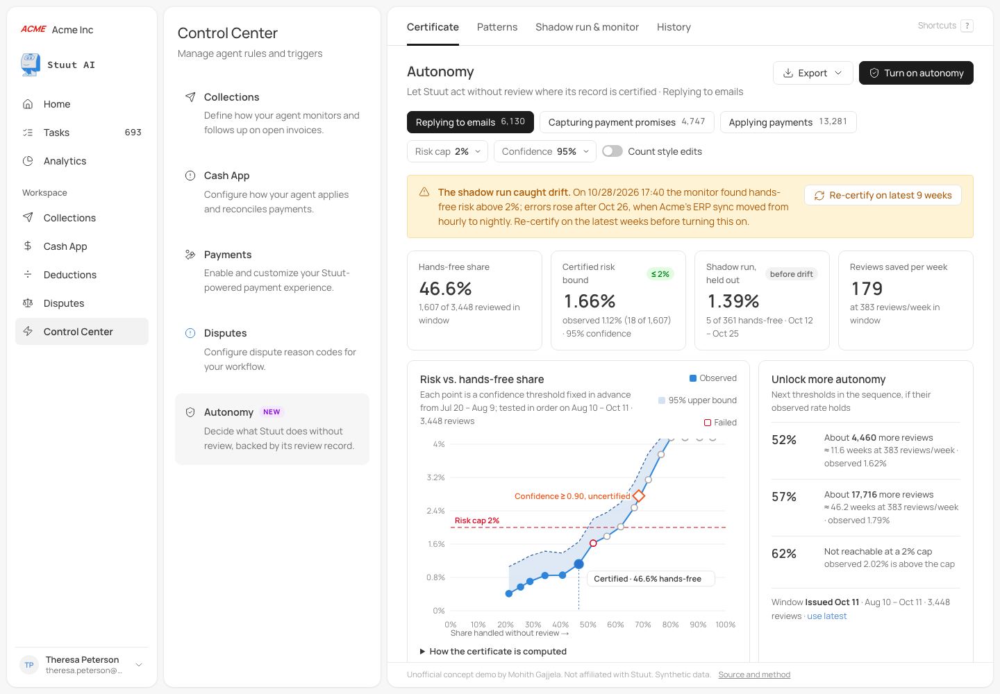

# Earned Autonomy for Stuut Agent

**Live demo:** https://mohith26.github.io/stuut-earned-autonomy/ · Unofficial concept demo by Mohith Gajjela. Not affiliated with Stuut. Synthetic data.

Stuut teams start with review turned on and, in Stuut's own words, the goal is "to learn from [review decisions] until the review step adds little, and teams are comfortable turning on full automation" ([Turning Human Review into Improvements](https://www.stuut.ai/dev-blog/turning-human-review-into-improvements), Oct 14 2026). Today that is a per-job switch. **Earned Autonomy** turns the review decisions Stuut already collects into a statistical certificate: for each job it finds the confidence threshold above which Stuut can act without review while guaranteeing, with 95% confidence, that at most 2% of that hands-free work would have been dismissed or materially changed by a reviewer. After it is turned on, an anytime-valid monitor watches a small audit sample and reverts the job to review on its own when the risk drifts above the cap. It lives where it would ship: **Control Center > Autonomy**, next to Collections, Cash App, Payments and Disputes.



## Results (seeded synthetic team "Acme Inc", `results/results.json`)

| Job | Reviews in window | Certified hands-free | Risk bound (95%) | Held-out shadow run | Plain 0.90 cutoff |
|---|---|---|---|---|---|
| Replying to emails | 3,448 | **46.6%** (conf ≥ 0.955) | 1.66% (observed 1.12%) | 1.39% before drift (5 of 361) | 68.4% hands-free at **2.76%** risk, breaks the cap |
| Applying payments (Cash App) | 7,525 | **69.2%** (conf ≥ 0.929) | 1.64% (observed 1.34%) | 1.03% (24 of 2,320) | 76.2% at 1.83% |
| Capturing payment promises | 2,646 | **0%** (nothing certifies at 2% yet) | – | – | 57.1% at **4.04%** risk |

Model ground truth at the certified thresholds (Monte Carlo from the generator): emails 1.89%, Cash App 1.30%, both under the 2% cap.

**Drift.** On Mon Oct 26 the synthetic customer's ERP sync moves from hourly to nightly, so many more replies describe already-paid invoices as open (the "payment reported after the agent ran" pattern from Stuut's post). In the shadow run, hands-free error on emails rose to **6.50%** (23 of 354). With every hands-free reply audited, the monitor reverted the job **2.7 days** after the drift began (Oct 28 17:40), after **7** bad hands-free replies; a weekly batch check fires Nov 2, after 15. At the revert, the monitor explains itself: hands-free error went from 1.12% to 5.65% in the trailing week, and an exact mix/rate decomposition traces **2.83 of those 4.53 points** to that one pattern (mostly because there was more of it). Re-certifying on the latest 9 weeks certifies nothing at 2% until that pattern (one click from the explanation) is set to always go to review, which brings back **56.4%** hands-free (bound 1.76%).

**Audit rate trade-off** (simulated jump from 1.12% to 6.50%, 300 drifts and 300 quiet years each):

| Audit rate | Audits/day | Median days to revert (monitor / weekly check) | False alarms per year (monitor / weekly check) |
|---|---|---|---|
| 100% | 25.5 | 4.9 / 7 | 0.3% / 7.7% |
| 50% | 12.8 | 10.6 / 7 | 0.0% / 20.7% |
| 25% | 6.4 | 18.8 / 14 | 0.0% / 9.7% |
| 10% | 2.6 | 47.2 / 21 | 0.0% / 47.7% |

The monitor is slower than a weekly check at low audit rates; it pays for that by almost never sending a healthy job back to review.

## How it works

1. **Grid, fixed in advance.** From a planning window (Jul 20 – Aug 9) the grid is built from confidence scores only, no outcomes: thresholds that would hand off 20%, 25%, ..., 95% of work.
2. **Certify (Learn then Test, fixed sequence).** On the calibration window (Aug 10 – Oct 11), test each threshold from the most conservative down with an exact binomial test of H: "selective risk > 2%". Stop at the first failure; the last passing threshold is certified. Family-wise error ≤ 5% (Angelopoulos, Bates, Candès, Jordan, Lei 2021). `src/autonomy.js: certify`
3. **Plan.** For the next thresholds, the reviews needed to certify them if their observed rate holds (`planUnlocks`), shown as "about 4,460 more reviews, ≈ 11.6 weeks".
4. **Shadow run.** The certificate is replayed on four held-out weeks (Oct 12 – Nov 8) where reviews stayed on.
5. **Monitor.** A betting e-process on audited hands-free outcomes, K_t = Π(1 + λ_i(X_i − 0.02)), with predictable Kelly bets from an exponentially weighted mean. Under "risk ≤ 2%" it is a nonnegative supermartingale, so by Ville's inequality the chance it ever crosses 20 is ≤ 5%. Crossing reverts the job (Waudby-Smith and Ramdas 2023). `eProcess`
6. **Why it fired.** At a revert, the change in hands-free error is split exactly across patterns into mix (more of a risky pattern) and rate (a pattern got worse) with a symmetric Kitagawa decomposition, so the fix (send that pattern to review, or fix upstream data) is one click away. `driftAttribution`
7. **Patterns.** Per named pattern (the groups from Stuut's review loop): change rate, median confidence, hands-free share and errors; any pattern can be set to "always review". Exclusions picked after viewing a window are marked provisional, because choosing them on the same data weakens the guarantee.

App features: four views (Certificate, Patterns with a case drill-down drawer, Shadow run & monitor, History in Audit Log style), turn on / turn off with a confirmation dialog and audit-rate choice, re-certify on the latest window, CSV/JSON export, deep links (`#/control-center/autonomy/monitor?job=email&audit=25`), state saved in `localStorage`, keyboard shortcuts (`1-3`, `c p m h`, `/`, `e`, `?`, `Esc`), loading and error states. Every number on the page is computed in the browser from `data/acme.json` by `src/`.

## Validity check

`node scripts/validity.mjs 300` draws 300 fresh teams from the generator and checks the certified threshold against model ground truth: true risk above the cap in 2.3% (emails), 1.3% (Cash App) and 2.3% (payment promises) of teams, all under the 5% target. It also shows the cost of the guarantee: the email job certifies something in 179 of 300 teams (mean 30.1% hands-free when it does), so Acme's 46.6% is on the favorable side.

## Run

```
node scripts/generate.mjs     # data/acme.json (seed 20261111)
node scripts/report.mjs       # results/results.json
node --test test/autonomy.test.mjs
python3 -m http.server        # then open http://localhost:8000
```

16 tests: closed-form binomial/CP values, CP coverage (randomized), fixed-sequence stopping, certificate validity against ground truth (randomized, 120 teams), planner, e-process false-alarm rate under H0 and power under a 3x jump (randomized), bet predictability, weekly check, exact drift decomposition, windows, headline numbers vs `results.json`, byte-identical regeneration, CSV escaping. A GitHub Actions workflow that runs them and fails if `results.json` drifts is in `ci/test.yml` (move it to `.github/workflows/` to activate; my push token lacked the workflow scope).

## Limitations (honest)

- **Synthetic data.** Volumes, job names, reviewer actions and pattern names follow Stuut's published description; rates, confidences and the drift are invented. The guarantee needs future work to look like the calibration window; the monitor exists because it will not always.
- **What counts as an error** is a product decision. The default counts dismissals and material edits; the "Count style edits" toggle counts any edit. Real review data mixes in reviewer habits (Stuut's post notes this), which the certificate inherits.
- **The guarantee is per job and per team.** Low-volume jobs (payment promises here) need months of reviews before anything certifies at 2%. Pooling across teams would help but needs care to keep the guarantee.
- **Fixed sequence is all-or-nothing at the top.** If Stuut's most confident bucket is bad (as after the drift), nothing certifies even if lower buckets are fine. That is the safe failure, but it can surprise people.
- The monitor is slow at low audit rates (table above). Confidence scores here are synthetic; the method needs a score, not a calibrated one.

## Prior art and what is new here

Selective prediction with risk guarantees is established: Learn then Test (Angelopoulos et al. 2021), conformal risk control (Angelopoulos et al. 2024), selective classification (Geifman and El-Yaniv 2017), and betting confidence sequences (Waudby-Smith and Ramdas 2023). Stuut's post cites "Learning Selective LLM Autonomy from Copilot Feedback", which automates low-risk steps from accept/reject feedback. Open-source tools such as Veridian apply conformal risk control as an autonomy dial for agents. In AR, Billtrust and HighRadius route cash-application matches by a confidence threshold the customer sets by hand. I did not find Stuut or an AR vendor shipping a certified per-job threshold with a held-out shadow run, a reviews-to-unlock planner and an anytime-valid auto-revert built on the review decisions the product already collects. That combination, placed in Stuut's Control Center, is the contribution.

Fonts (Manrope, Source Code Pro), colors, radii and shadows come from Stuut's production stylesheet; the shell follows public screenshots of the app. Icons are Lucide (the app uses Font Awesome Pro).
